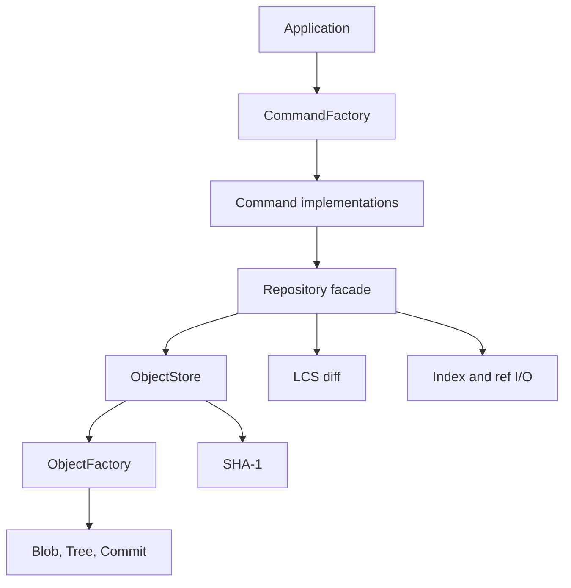

# Architecture

## Patterns and ownership

| Pattern/concept | Implementation | Benefit |
|---|---|---|
| Command | `Command::execute` and concrete `InitCommand`, `AddCommand`, `CommitCommand`, etc. | Each CLI action owns its argument validation and delegates repository work |
| Factory | `CommandFactory::create` | Converts command names into `std::unique_ptr<Command>` without exposing concrete classes |
| Factory | `ObjectFactory::decode` | Validates stored bytes and creates the appropriate polymorphic Blob, Tree or Commit |
| Facade | `Repository` | Presents staging, commit, branch, checkout, history and diff through a single API |
| Polymorphism | `Object::type`, `Object::serialize`, `Command::execute` | Dispatches object/command behavior through virtual interfaces |
| Smart pointers | Factory returns use `std::unique_ptr` | Single ownership with deterministic destruction; no owning raw pointers |
| RAII | `RepoLock`, file streams, value-owned containers | Releases locks and resources on success and exception paths |

`dynamic_cast` checks an object's concrete type after loading from the object store. These pointers are temporary, non-owning views; the `unique_ptr` retains ownership. `shared_ptr` is unnecessary because factories transfer exclusive ownership.

## Component relationships

## Persistent representation

| Path | Contents |
|---|---|
| `.minigit/FORMAT` | `minigit 1` and newline |
| `.minigit/HEAD` | `ref: refs/heads/<branch>` and newline |
| `.minigit/refs/heads/<branch>` | Full commit ID and newline; empty for initial main |
| `.minigit/objects/ab/cdef...` | Uncompressed framed bytes for object ID `abcdef...` |
| `.minigit/index` | Binary snapshot map described below |
| `.minigit/LOCK/` | Exclusive writer lock directory, present only while writing normally |

### Objects

Every object ID is SHA-1 of `type + space + decimal payload byte count + NUL + payload`. IDs are lowercase 40-digit hex. Storage divides them into a two-character directory and 38-character filename. Reading an object verifies its hash, header, length, type and canonical re-encoding.

A blob is exact file bytes, including NULs and line endings. Identical file contents share an object regardless of filename.

A tree contains immediate directory entries. Each entry is `mode + space + name + NUL + raw 20-byte object ID`; mode is `100644` for blobs and `40000` for subtrees. Names are unique. Entries are sorted by name, with a slash appended to directory names for comparison, matching Git's ordering for these supported modes. Nested directories create nested trees; unchanged content naturally deduplicates.

A commit payload contains a tree ID, optional parent ID, author and committer lines, a blank line, then the message. This implementation uses identical author/committer identities and Unix timestamps with `+0000`. It does not parse arbitrary external Git commit headers. Parent references form a single-parent history; branches can diverge by advancing different refs.

### Index

The index is a complete prospective snapshot, not a list of deltas:

1. Five bytes: `MGIX` and version byte `0x01`.
2. Unsigned big-endian 32-bit entry count.
3. For each lexicographically sorted path: big-endian 32-bit path byte length, path bytes, raw 20-byte blob ID.

Readers reject truncation, trailing data, duplicate paths, invalid object IDs and file/directory prefix conflicts. `add` creates blobs immediately. A commit uses these stored blobs, not whatever is currently on disk.

## Operation flows

### Add and commit

1. Acquire the writer lock and load the existing index.
2. For `add`, replace each requested subtree with its current regular files; omission of a previously indexed file stages its deletion.
3. Write immutable blobs before replacing the index. A failed multi-path add leaves the old index intact, although unreachable blobs may remain.
4. For `commit`, validate and convert the full index into nested trees.
5. Store a commit pointing at the root tree and previous branch tip.
6. Atomically replace the branch ref. The index already describes the committed snapshot and stays intact.

### Checkout

1. Validate the branch, target commit, all target trees and referenced blobs.
2. Require the index to match HEAD and all current tracked files to match the index.
3. Reject untracked files that overlap target file paths or their ancestors/descendants; check untracked empty directory obstructions too.
4. Load changed target blob contents before altering the worktree.
5. Remove obsolete tracked files and prune their empty directories; write changed/new files.
6. Replace the index and symbolic HEAD.

Unrelated untracked files survive. Checks avoid ordinary data-loss cases, but steps 5–6 are not transactional across disk/process failures. Filesystem races are outside the intended trusted, local, single-writer use case.

### Diff

The three diff modes select snapshot pairs: index/worktree, HEAD/index, or revision/revision. A sorted path comparison classifies additions, deletions and modifications. Text files are split into lines while retaining newline bytes.

For suffixes starting at `i` and `j`, the LCS recurrence is:

- Equal lines: `L[i][j] = 1 + L[i+1][j+1]`.
- Otherwise: `L[i][j] = max(L[i+1][j], L[i][j+1])`.

Backtracking emits equal/delete/insert edits. Ties choose deletion first for deterministic output. The minimal insertion/deletion count is `n + m - 2L[0][0]`. Tests compare random small examples with an independent exhaustive subsequence oracle. Newline termination is part of line identity; binary NUL-containing files bypass text diff.

## Costs and tradeoffs

| Operation | Principal cost |
|---|---|
| SHA-1/blob insertion | O(B) time and O(B) memory for B bytes in this in-memory implementation |
| Index read/write | O(P log P) construction and O(P) serialized entries for P paths, plus path-byte lengths |
| Tree creation | O(B + P log P) approximately, including validating referenced blob bytes |
| Status | Reads/hashes working files plus validates HEAD objects; no mtime cache |
| LCS | O(nm) time and memory, limited to 16 million uint32 cells (~64 MB matrix) |
| Checkout collision checks | O(TW) path comparisons for T target and W working files, plus I/O; suited to small projects |
| Log | O(C) commits and their metadata bytes |

Possible extensions include compressed objects, SHA-256 addressing, a path trie for checkout planning, Hirschberg's linear-space LCS, atomic checkout journaling, ignore patterns and three-way merge. They are intentionally not presented as implemented features.
